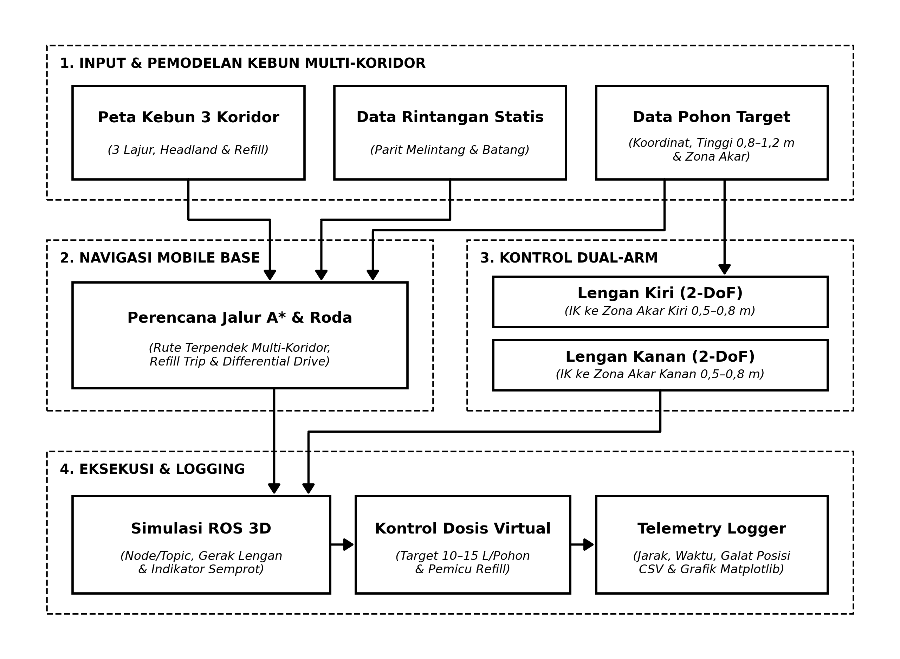
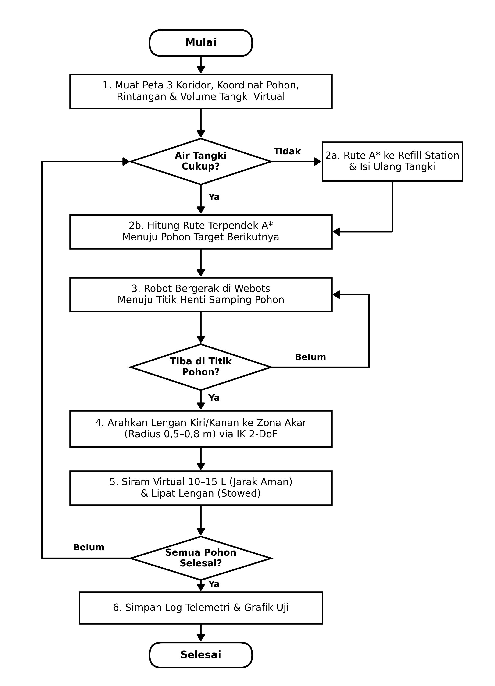

# Perancangan dan Simulasi 3D Dual-Arm Mobile Robot Berbasis ROS untuk Navigasi Jalur Terpendek A* dan Penyiraman Presisi pada Perkebunan Jeruk Limau

**Penulis:** Rahmad Hamdi Siregar (101032330026), Maheswara Ariq Athallah (101032300050), Daffa Hermansyah (101032330090), Muhammad Al Qarnie (101032330043), dan Farrel Erza Farrandi (101032330169)  
**Afiliasi:** Program Studi S1 Teknik Komputer, Fakultas Teknik Elektro, Universitas Telkom, Bandung, Indonesia  
**Mata Kuliah:** Robotics and Intelligent System (CEH4C3) — Draft Laporan Akhir (Section I & II)

---

**ABSTRAK**  
Pengelolaan irigasi pada perkebunan buah berjalur lurus panjang, seperti perkebunan jeruk limau, masih menghadapi kendala keseragaman distribusi air. Penyiraman manual tidak efisien untuk jalur panjang, sedangkan sistem pipa, selang, atau *sprinkler* konvensional rentan mengalami penurunan tekanan air (*pressure drop*) dan pemborosan air di luar zona akar. Makalah ini merancang simulasi robot penyiram beroda dua lengan (*Dual-Arm Mobile Robot*) berbasis **ROS (*Robot Operating System*)** dan **Python**. Sistem menggabungkan pencarian rute terpendek menggunakan algoritma **A\*** pada roda *differential drive* dengan kendali dua lengan planar 2-DoF berbasis *Inverse Kinematics* secara *goal-coordinated* agar ujung semprot tepat mengarah ke zona akar (radius $0{,}5\text{--}0{,}8\text{ m}$) sesuai tinggi tajuk ($0{,}8\text{--}1{,}2\text{ m}$) tanpa menyentuh batang utama. Rancangan ini disiapkan untuk diuji pada arena simulasi 3D tiga koridor (9–12 pohon uji dan proyeksi skala kebun 100 m) dengan target waktu komputasi rute di bawah $50\text{ ms}$, galat posisi ujung lengan maksimal $3\text{ cm}$, takaran air virtual $10\text{--}15\text{ liter/pohon}$ ($\pm 5\%$), dan waktu kerja rata-rata maksimal $24\text{ detik/pohon}$.

**KATA KUNCI**  
*Dual-Arm Mobile Robot*, ROS, Algoritma A*, *Inverse Kinematics* 2-DoF, Penyiraman Presisi, Jeruk Limau.

---

## I. PENDAHULUAN

Dalam praktik pertanian presisi pada perkebunan buah berjalur lurus dan panjang, seperti kebun jeruk limau, keseragaman distribusi air ke setiap tanaman merupakan faktor penting untuk menjaga pertumbuhan optimal. Penyiraman manual sulit mempertahankan konsistensi volume air antar-pohon dan membutuhkan waktu serta tenaga yang besar saat menjangkau koridor yang panjang. Di sisi lain, penggunaan sistem irigasi pipa, selang, atau *sprinkler* konvensional pada jalur panjang rentan mengalami penurunan tekanan air (*pressure drop*) dari pangkal ke ujung jalur, sehingga takaran air yang diterima tanaman menjadi tidak merata. Metode penyiraman konvensional tersebut juga cenderung boros karena membasahi area di luar zona akar, berisiko membasahi pangkal batang secara berlebihan, serta instalasi pipa atau selang panjang rawan mengganggu akses lorong dan tersangkut saat perawatan kebun [8]. Untuk tanaman jeruk limau, kebutuhan air ideal sebesar $10\text{--}15\text{ liter/pohon}$ perlu diarahkan langsung ke zona perakaran pada radius $0{,}5\text{--}0{,}8\text{ m}$ tanpa mengenai batang utama.

Perkembangan robotika pertanian membuka peluang untuk mengotomatisasi pekerjaan penyiraman dan penyemprotan selektif pada kebun buah berjalur lurus secara lebih konsisten serta efektif menekan pemborosan dibanding penyiraman seragam [3]–[6], [10]. Pada lorong kebun yang sempit, penggunaan *mobile robot* beroda dengan sepasang lengan manipulator (*dual-arm*) sangat sesuai karena menerapkan strategi *goal-coordinated*: dua lengan identik bekerja bersamaan secara independen untuk menyiram barisan pohon di sisi kiri dan kanan tanpa perlu manuver putar balik [3], [11]. Selain itu, konsep robot tangki mandiri tanpa selang panjang dipilih agar pergerakan di koridor bebas hambatan dan tidak tersangkut pada batang pohon [8].

Berdasarkan kebutuhan tersebut, makalah ini merancang simulasi **Dual-Arm Mobile Robot** berbasis **ROS (*Robot Operating System*)** dengan pengendali **Python** [1]. Pemilihan tahap simulasi sejalan dengan tinjauan literatur robotika pertanian yang menunjukkan lebih dari separuh studi kendali robot bergerak divalidasi terlebih dahulu di lingkungan simulasi sebelum uji lapangan [9]. Tujuan utama sistem ini adalah: (1) mencari lintasan terpendek bebas tabrakan melewati 3 koridor lurus panjang (diuji pada petak 9–12 pohon serta proyeksi skala kebun 100 m) sekaligus mengatur rute kembali ke *refill station* menggunakan algoritma **A\***; dan (2) mengarahkan sepasang lengan 2-DoF berbasis *Inverse Kinematics* secara tepat ke zona akar sesuai tinggi tajuk pohon ($0{,}8\text{--}1{,}2\text{ m}$) tanpa mengenai batang utama.

Sebagai tahap awal laporan akhir, dokumen ini menyajikan dua bagian inti. **Section I** memaparkan permasalahan umum irigasi pada kebun buah berjalur lurus, urgensi otomatisasi berbasis *dual-arm mobile robot*, serta tujuan perancangan sistem. **Section II** menjelaskan arsitektur sistem berbasis ROS, metode navigasi *mobile base*, pemodelan *Inverse Kinematics* lengan 2-DoF, alur kerja *Finite State Machine* (FSM), serta rencana skenario dan target metrik pengujian simulasi.

---

## II. ARSITEKTUR SISTEM DAN METODOLOGI

### A. Gambaran Umum Sistem & Lingkungan Simulasi ROS

Agar mudah dikembangkan dan diuji, seluruh sistem dibagi menjadi empat blok fungsional utama seperti ditunjukkan pada **Gambar 1**: (1) *Input & Pemodelan Kebun Multi-Koridor*, (2) *Navigasi Mobile Base*, (3) *Kontrol Dual-Arm*, dan (4) *Eksekusi & Logging*.

Lingkungan kebun dimodelkan dalam dua bentuk yang saling terhubung:
1. **Arena Simulasi 3D di ROS (Gazebo/RViz) & Model URDF:** Berisi model 3D *mobile robot* beroda dengan dua lengan kiri-kanan, 3 koridor tanaman, jalan penghubung antar-koridor (*headland*), rintangan statis (parit melintang/area halangan), dan 1 titik isi ulang air (*refill station*).
2. **Peta Grid Statis 2D (*Known Map*):** Representasi peta kotak-kotak (*weighted graph*) yang menyimpan koordinat pohon, tinggi tajuk ($0{,}8\text{--}1{,}2\text{ m}$), posisi rintangan, dan lokasi titik *refill* [1], [2]. Penggunaan *known map* dipilih agar robot fokus pada perencanaan jalur dan kendali gerak tanpa beban komputasi kamera *computer vision* yang berat.

Seluruh komponen berkomunikasi secara modular melalui *node* dan *topic* di **ROS**, dengan ringkasan fungsi tiap bagian pada **Tabel 1**.

| Bagian Sistem | Fungsi Utama pada Simulasi ROS |
| :--- | :--- |
| **Arena 3D & Peta 2D** | Menyediakan model robot URDF, 3 koridor tanaman, rintangan statis, dan *known map*. |
| **Node Navigasi A\*** | Menghitung rute terpendek antar-pohon serta rute *refill*, lalu mengirim perintah kecepatan roda. |
| **Node Dual-Arm 2-DoF** | Menghitung sudut bahu dan siku (*Inverse Kinematics*) lengan kiri dan kanan. |
| **Node Dosis & Logger** | Mengatur durasi/indikator semprot virtual 10–15 L/pohon dan merekam metrik ke CSV. |

### B. Navigasi Mobile Base (Differential Drive & Algoritma A*)

Penggerak utama robot menggunakan konfigurasi ***differential drive*** yang terdiri atas dua roda penggerak kiri dan kanan serta roda penyeimbang (*caster*) [1]. Arah dan kecepatan robot diatur dari selisih putaran roda kiri dan kanan: putaran sama menghasilkan gerak lurus, sedangkan selisih putaran membuat robot berbelok menuju titik *waypoint* berikutnya.

Untuk perencanaan rute, digunakan pendekatan *Metric Path Planning* dengan **algoritma A\*** pada peta grid 2D [1], [2]. Algoritma A\* mencari lintasan terpendek dari posisi robot saat ini menuju titik henti di samping pohon target sambil menghindari sel rintangan statis dan batang pohon. Karena *mobile robot* beroda memiliki batas daya angkut tangki air (*payload* terbatas) [8], *node* navigasi memantau sisa volume tangki virtual dan otomatis mengalihkan tujuan A\* ke *refill station* ketika air tidak cukup untuk pohon berikutnya.

### C. Kontrol Dual-Arm Manipulator (2-DoF Inverse Kinematics)

Robot dilengkapi sepasang lengan planar **2-DoF** (*two-link rigid manipulator*) di sisi kiri dan kanan yang masing-masing memiliki dua sendi putar (*bahu* dan *siku*) dengan panjang tautan $L_1 = 0{,}45\text{ m}$ dan $L_2 = 0{,}45\text{ m}$ (total jangkauan $0{,}90\text{ m}$). Mekanisme dua derajat kebebasan (2-DoF) berbodi kaku dipilih karena model kinematikanya sederhana, gerakannya lebih stabil, dan risiko kegagalannya lebih rendah dibanding lengan dengan banyak sendi untuk tugas penyemprotan kebun [4], [12].

Saat robot berhenti di samping pohon, koordinat zona akar ($0{,}5\text{--}0{,}8\text{ m}$ dari pusat batang) dan ketinggian tajuk ($0{,}8\text{--}1{,}2\text{ m}$) pada *Task Space* dipetakan menjadi sudut sendi bahu ($\theta_1$) dan siku ($\theta_2$) pada *Joint Space* menggunakan **Inverse Kinematics** sederhana [1]. Penyesuaian posisi semprot terhadap variasi tinggi tajuk ini sejalan dengan prinsip penyemprotan presisi kebun buah [7], sambil menjaga ujung penyiram pada jarak aman dari batang utama sebelum dilipat kembali (*stowed*).

### D. Alur Kerja (FSM), Dosis Virtual & Rencana Uji

Alur kerja keseluruhan robot diatur menggunakan **Finite State Machine (FSM)** seperti pada **Gambar 2** [1]. Siklus dimulai dengan memuat peta 3 koridor, koordinat pohon, rintangan, dan volume awal tangki virtual. Sebelum menuju pohon berikutnya, sistem memeriksa kecukupan air tangki virtual: jika kurang, robot menjalankan rute A\* ke *refill station*; jika cukup, robot menghitung rute A\*, bergerak di simulasi ROS ke samping pohon, mengarahkan lengan 2-DoF, melakukan penyiraman virtual 10–15 L dengan indikator visual di simulator, lalu melipat lengan hingga seluruh pohon selesai dan log uji tersimpan ke CSV/grafik.

Pengujian sistem mencakup tiga skenario: (1) uji variasi tinggi pohon ($0{,}8\text{ m}$, $1{,}0\text{ m}$, dan $1{,}2\text{ m}$); (2) uji navigasi multi-koridor A\* melewati rintangan statis pada petak uji 3 koridor berisi $9\text{--}12\text{ pohon}$ beserta proyeksi matematis ke kebun $100\text{ m}$; dan (3) uji penjadwalan *refill* tangki virtual serta jarak aman batang utama, dengan target keberhasilan pada **Tabel 2**.

| Parameter Uji | Target Keberhasilan |
| :--- | :--- |
| **Efisiensi Jalur A\*** | Menghasilkan rute terpendek antar-koridor tanpa menabrak rintangan. |
| **Waktu Hitung A\*** | Waktu komputasi rute di bawah $50\text{ ms}$. |
| **Ketepatan Ujung Lengan** | Galat posisi ujung semprot $\le 3\text{ cm}$ dari zona akar ($0{,}5\text{--}0{,}8\text{ m}$) & bebas tabrakan. |
| **Takaran & Laju Kerja** | Takaran virtual $10\text{--}15\text{ L}$ ($\pm 5\%$) dengan waktu kerja rata-rata $\le 24\text{ detik/pohon}$. |

---

## REFERENSI

[1] Materi Kuliah *Robotics and Intelligent System* (CEH4C3): *Lecture 1* (Introduction to Robotics), *Lecture 3* (Kinematics), *Lecture 4* (Path & Trajectory Planning), *Lecture 5* (Robot Autonomy & FSM), *Lecture 6* (Metric Path Planning A\*), dan *Lecture 9* (ROS), Universitas Telkom.  
[2] R. R. Murphy, *Introduction to AI Robotics*, MIT Press; dan buku acuan kuliah CEH4C3 (*Fundamental of Robotics* & *Robot Mechanical System*).  
[3] L. Qin, "Recent progress and challenges of key technologies in robotic assembly," *Chinese Journal of Mechanical Engineering*, vol. 39, p. 100032, 2026.  
[4] S. I. Abdelmaksoud, M. H. Al-Mola, G. E. M. Abro, and V. S. Asirvadam, "In-Depth Review of Advanced Control Strategies and Cutting-Edge Trends in Robot Manipulators," *IEEE Access*, vol. 12, pp. 47672–47701, 2024.  
[5] Q. Zhang, M. Karkee, and A. Tabb, "The use of agricultural robots in orchard management," in *Robotics and automation for improving agriculture*, Burleigh Dodds Science Publishing, 2019, pp. 187–214.  
[6] D. Gerdan Koc, C. Koc, and M. Comakli, "AI-powered autonomous spraying robot for precision orchard applications," *Journal of Agricultural Engineering*, 2026.  
[7] Y. Wang, W. Jia, M. Ou, X. Wang, and X. Dong, "A Review of Orchard Canopy Perception Technologies for Variable-Rate Spraying," *Sensors*, vol. 25, p. 4898, 2025.  
[8] Y. Xia et al., *Front. Plant Sci.*, vol. 14, 2023; dan N. Elkaoud et al., "Efficient and Effective Irrigation Water Management Using Sprinkler Robot," *Eng*, vol. 6, no. 7, p. 138, 2025.  
[9] R. Gu et al., *Front. Plant Sci.*, 2026 (tinjauan sistematis 131 studi robotika pertanian); dan Open Robotics, *ROS Documentation*.  
[10] R. Oberti, M. Marchi, P. Tirelli, A. Calcante, M. Iriti, et al., "Selective spraying of grapevines for disease control using a modular agricultural robot," *Biosystems Engineering*, vol. 146, pp. 203–215, 2016.  
[11] Y. Jo, Y. Park, J. Seol, J. Pak, B. Kim, C. Kim, and H. I. Son, "A Review on Dual-Arm Manipulation in Agriculture," *IEEE Access*, vol. 13, pp. 150379–150399, 2025.  
[12] S. A. Abbas, W. S. Qureshi, and A. Munir, "Design and Development of an Unmanned Orchard Spraying Robot with Two Degrees of Freedom," *Proc. IECON 2024 – 50th Annual Conference of the IEEE Industrial Electronics Society*, 2024.
