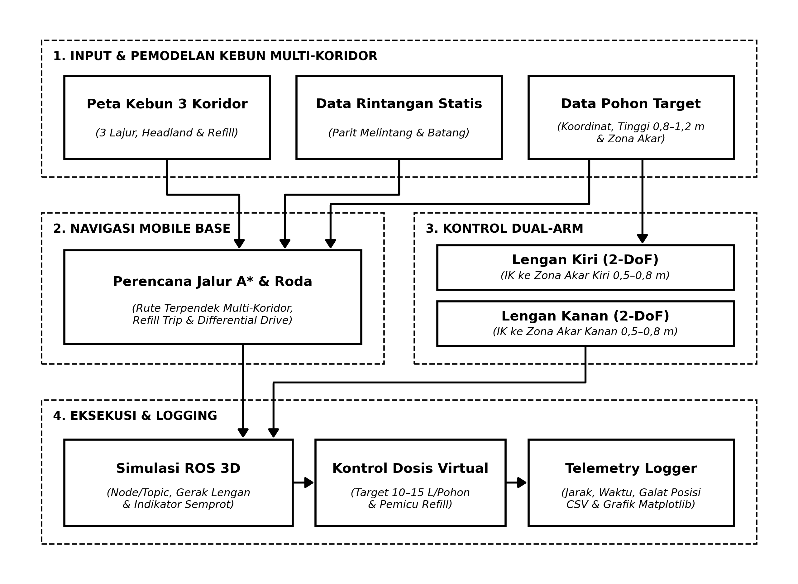
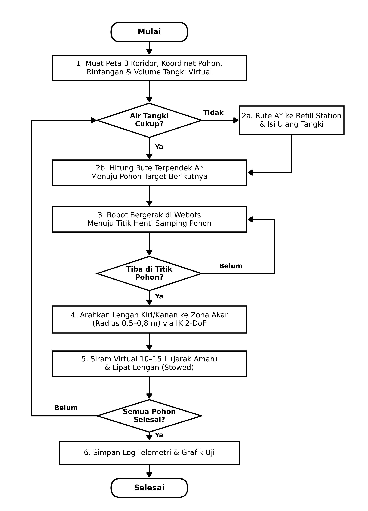

# PROPOSAL SINGKAT TUGAS BESAR — TAHAP 1: PERENCANAAN SISTEM
**Mata Kuliah:** Robotics and Intelligent System (CEH4C3)  
**Program Studi:** S1 Teknik Komputer — Fakultas Teknik Elektro, Universitas Telkom  
**Topik Pilihan:** *Shortest Path Implementation on Robotic*  
**Judul Usulan:** Perancangan dan Simulasi 3D *Dual-Arm Mobile Robot* Berbasis Webots untuk Navigasi Jalur Terpendek A* dan Penyiraman Presisi pada Perkebunan Jeruk Limau

---

## 1. Identitas & Pembagian Peran Kelompok

| No | Nama Anggota | NIM | Peran Utama |
| :---: | :--- | :---: | :--- |
| 1 | Rahmad Hamdi Siregar | 101032330026 | Aturan Dosis Air Virtual, Skenario Uji & Laporan |
| 2 | Maheswara Ariq Athallah | 101032300050 | Gerak & Sudut Lengan *Dual-Arm* 2-DoF |
| 3 | Daffa Hermansyah | 101032330090 | Pembuatan Kebun 3D & Robot di Webots |
| 4 | Muhammad Al Qarnie | 101032330043 | Alur Sistem & Rute Terpendek A* |
| 5 | Farrel Erza Farrandi | 101032330169 | Skrip Python, Pengujian & Grafik Hasil |

---

## 2. Latar Belakang & Ide Utama

Untuk topik **Shortest Path Implementation on Robotic**, kami mengambil kasus nyata dari kebun jeruk limau (*Citrus amblycarpa*) di Desa Ciberes, Subang. Lahan kebun ini seluas sekitar $3.000\text{ m}^2$ dengan 3 jalur tanaman sepanjang $\sim 100\text{ m}$ (total $500\text{--}600\text{ pohon}$). Selama ini penyiraman masih dikerjakan manual oleh 4 orang memakai ember dengan ongkos Rp400.000 sekali siram (sekitar Rp48,7 juta per tahun). Selain biayanya mahal, siraman ember membuat takaran air tiap pohon tidak sama dan sering mengenai pangkal batang. Padahal batang yang terus basah mudah terserang jamur *Phytophthora nicotianae* (busuk akar). Idealnya, satu pohon butuh **$10\text{--}15\text{ liter}$** air yang disiram ke tanah di sekitar akar pada jarak **$0{,}5\text{--}0{,}8\text{ m}$** dari batang.

**Ide Utama:**  
Kami ingin membuat simulasi robot penyiram beroda dua lengan (**Dual-Arm Mobile Robot**) di aplikasi 3D **Webots** yang dikendalikan lewat **Python**. Cara kerjanya menggabungkan dua hal:
1. **Mencari rute terpendek (Algoritma A\*):** Robot beroda (penggerak dua roda kiri-kanan / *differential drive*) berjalan melewati 3 jalur kebun tanpa menabrak halangan seperti parit atau pembatas, lalu bisa otomatis balik ke titik isi ulang air (*refill*) kalau tangki virtualnya hampir habis.
2. **Menyiram tepat ke area akar (Dua Lengan 2-DoF):** Begitu sampai di sebelah pohon, dua lengan robot di kiri dan kanan otomatis bergerak ke arah tanah sekitar akar ($0{,}5\text{--}0{,}8\text{ m}$) dan menyesuaikan tinggi pohon ($0{,}8\text{--}1{,}2\text{ m}$) supaya air tidak mengenai batang utama.

---

## 3. Bagian Sistem & Cara Kerjanya

Pada Tahap 1 ini kami fokus pada konsep kerjanya dulu agar mudah dipahami. Secara garis besar, simulasi kami dibagi menjadi lima bagian:

| Bagian Sistem | Cara Kerja Sederhana |
| :--- | :--- |
| **Kebun 3D & Peta Grid** | Kebun dibuat dalam versi 3D di Webots dan peta kotak-kotak 2D (*known map*) yang berisi 3 jalur tanaman, jalan penghubung ujung jalur (*headland*), halangan diam, dan 1 titik isi ulang air. |
| **Jalan Robot (Roda & A\*)** | Memakai algoritma **A\*** untuk mencari rute paling singkat antar-pohon maupun saat balik ke titik *refill*, lalu diterjemahkan menjadi putaran roda kiri-kanan (*differential drive*). |
| **Dua Lengan Robot (2-DoF)** | Lengan kiri dan kanan (tiap lengan punya 2 ruas masing-masing $0{,}45\text{ m}$, total jangkauan $0{,}90\text{ m}$) memakai hitungan **Inverse Kinematics** sederhana untuk menentukan sudut tekuk bahu dan siku agar ujung semprot tepat di atas area akar. |
| **Takaran Air & *Refill* Virtual** | Lama waktu semprot diatur supaya tiap pohon mendapat jatah $10\text{--}15\text{ liter}$. Sisa air di tangki virtual terus dipantau; jika kurang, robot langsung mencari jalan pulang ke titik isi ulang. |
| **Aplikasi Simulasi** | Semua simulasi berjalan di **Webots** dengan program **Python** (`NumPy` untuk hitung rute dan sudut lengan, serta `Matplotlib`/CSV untuk mencatat dan membuat grafik hasil uji). |

---

## 4. Arsitektur & Alur Kerja Robot

### A. Diagram Blok Sistem

### B. Alur Kerja Robot (Flowchart)

---

## 5. Fitur Simulasi & Target Uji

### Yang Akan Dibuat di Tahap 2:
1. **Model Kebun 3 Jalur di Webots:** Membuat 1 arena kebun 3D sederhana di Webots beserta peta 2D-nya, lengkap dengan variasi tinggi pohon ($0{,}8\text{--}1{,}2\text{ m}$), halangan diam, dan titik isi ulang.
2. **Rute Terpendek A\* & Isi Ulang:** Program Python mencari jalur paling pendek antar-pohon dan otomatis kembali ke titik *refill* saat tangki virtual menipis.
3. **Gerak Lengan Kiri-Kanan (2-DoF):** Mengarahkan ujung lengan ke titik akar sesuai koordinat dan tinggi pohon dari peta tanpa menyentuh batang.
4. **Simulasi Siram & Catatan Hasil:** Menandai semprotan air secara visual sesuai durasi jatah $10\text{--}15\text{ liter}$ per pohon, lalu menyimpan jarak, waktu, dan galat ke file CSV serta grafik.

### Target yang Diuji di Tahap 3:

| Yang Diuji | Target Keberhasilan |
| :--- | :--- |
| **Jalur Terpendek A\*** | Robot mengambil rute paling singkat antar-jalur tanpa menabrak halangan. |
| **Kecepatan Hitung A\*** | Waktu komputer menghitung rute di bawah $50\text{ ms}$. |
| **Ketepatan Ujung Lengan** | Selisih posisi ujung semprot paling jauh $3\text{ cm}$ dari target area akar ($0{,}5\text{--}0{,}8\text{ m}$) dan tidak menyentuh pohon. |
| **Takaran & Kecepatan Kerja** | Takaran virtual $10\text{--}15\text{ L}$ ($\pm 5\%$) dengan waktu kerja rata-rata maksimal $24\text{ detik}$ per pohon. |

**Rencana Skenario Uji:** (1) Menguji tinggi pohon berbeda ($0{,}8\text{ m}$, $1{,}0\text{ m}$, dan $1{,}2\text{ m}$); (2) Menguji robot melewati 3 jalur yang punya halangan pada petak uji berisi $9\text{--}12\text{ pohon}$ (lalu dihitung perkiraannya untuk kebun $100\text{ m}$); dan (3) Menguji jadwal balik isi ulang tangki serta jarak aman dari batang pohon.

---

## 6. Jadwal Kerja & Referensi

| Tahap | Kegiatan | Hasil yang Dikumpulkan | Waktu |
| :---: | :--- | :--- | :---: |
| **Tahap 1** | Perencanaan Sistem | Proposal singkat konsep robot dan alur A* | Minggu 1–2 |
| **Tahap 2** | Pengerjaan Simulasi | Arena & robot 3D di **Webots** + program **Python** (A*, lengan 2-DoF, takaran air) | Minggu 3–4 |
| **Tahap 3** | Pengujian & Analisis | Laporan hasil 3 skenario uji, grafik, dan evaluasi | Minggu 5–6 |
| **Final** | Presentasi & Demo | Video rekaman simulasi Webots & slide presentasi | Menjelang Demo |

**Referensi:**
1. Materi Kuliah *Robotics and Intelligent System* (CEH4C3) [Acuan Utama]: *Lecture 1* (Pengenalan Robotika & Mobile Robot), *Lecture 3* (Kinematika — Inverse Kinematics Lengan 2-Ruas), *Lecture 4* (Perencanaan Jalur: Task Space & Joint Space), *Lecture 5* (Otonomi Robot & FSM), dan *Lecture 6* (Navigasi Robot — Metric Path Planning A\*).
2. Buku Acuan Kuliah CEH4C3: *Introduction to AI Robotics*, *Fundamental of Robotics*, dan *Robot Mechanical System*.
3. Dokumen Capstone Design CD-1 & CD-2: *Analisis Permasalahan & Spesifikasi Sistem Irigasi Kebun Jeruk Limau di Ciberes, Subang* (Prodi S1 Teknik Komputer, Universitas Telkom, 2026).
4. Referensi Tugas Mata Kuliah (*Assesment 1 & 2*): Qin, L. (*CJME*, 2026) tentang metrik evaluasi robot & Abdelmaksoud dkk. (*IEEE Access*, 2024) tentang kendali lengan manipulator.
5. Dokumentasi Resmi Webots (Cyberbotics Ltd.).
