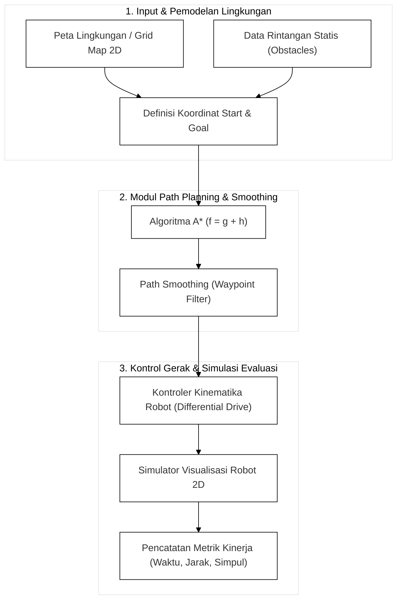
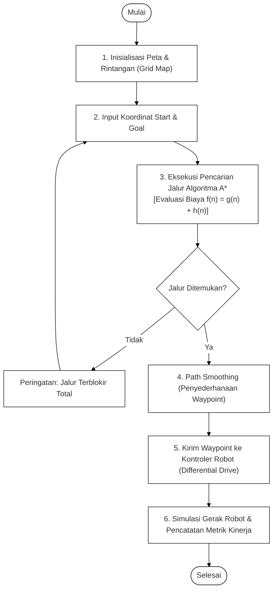

# LAPORAN TUGAS BESAR - TAHAP 1: PERENCANAAN SISTEM
**Mata Kuliah:** Robotics and Intelligent System (CEH4C3)  
**Topik:** Shortest Path Implementation on Robotic  
**Judul Proyek:** Perancangan Sistem Navigasi Otonom Berbasis Algoritma Shortest Path A* pada Mobile Robot

---

## 1. Identitas Kelompok
* **Program Studi:** S1 Teknik Komputer
* **Anggota Kelompok:**
  1. [Nama Anggota 1] - [NIM 1]
  2. [Nama Anggota 2] - [NIM 2]
  3. [Nama Anggota 3] - [NIM 3]

---

## 2. Deskripsi dan Latar Belakang Proyek

Pada sistem robot bergerak otonom (*autonomous mobile robot*), kemampuan untuk menentukan rute tercepat dan teraman dari titik awal (*start*) menuju titik tujuan (*goal*) merupakan fungsi yang sangat mendasar. Dalam lingkungan operasional indoor, robot sering kali menghadapi berbagai kendala seperti keberadaan rintangan statis, lorong yang sempit, serta kebutuhan manuver yang efisien.

Proyek ini merancang sistem simulasi navigasi otonom yang mengimplementasikan **Algoritma A\* (A-Star)** sebagai metode pencarian jalur terpendek (*shortest path planning*). Algoritma A* dipilih karena merupakan metode pencarian jalur optimal berbasis grid yang paling andal, efisien, dan memiliki jaminan kelengkapan (*complete and optimal*). Algoritma ini memadukan akumulasi jarak tempuh riil $g(n)$ dan estimasi jarak heuristik $h(n)$ ke titik tujuan.

Seluruh perancangan, implementasi, dan pengujian sistem direalisasikan secara **penuh dalam bentuk simulasi** tanpa membebani kebutuhan perangkat keras fisik, namun tetap memberikan analisis performa ilmiah yang mendalam dan terukur sesuai capaian pembelajaran mata kuliah.

---

## 3. Ruang Lingkup dan Batasan Sistem

1. **Model Robot:** Menggunakan model kinematika *Differential Drive Mobile Robot* (2 roda penggerak independen dan 1 roda kastor pasif).
2. **Lingkungan Kerja:** Denah ruangan 2D indoor yang direpresentasikan ke dalam bentuk *Occupancy Grid Map* dengan batas dinding dan rintangan statis.
3. **Fokus Algoritma:** Fokus tunggal pada Algoritma A* (A-Star) dengan dua opsi fungsi heuristik matematis (Euclidean dan Manhattan) untuk meminimalkan beban pengerjaan sistem.
4. **Batasan Simulasi:** Sistem murni berbasis simulasi 2D terintegrasi (Python GUI / Matplotlib) sehingga komputasi sangat ringan, instan dieksekusi, dan bebas risiko error fisik.
5. **Metode Evaluasi:** Pengujian kuantitatif performa A* pada berbagai variasi kompleksitas peta dan perbandingan efisiensi fungsi heuristik.

---

## 4. Desain Arsitektur Sistem

Arsitektur sistem dirancang secara linear dan terstruktur ke dalam tiga subsistem utama:

### Penjelasan Komponen Blok:
1. **Subsistem Pemodelan Lingkungan & Input:** Bertanggung jawab memuat matriks *Occupancy Grid* 2D (nilai 0 untuk ruang bebas dan nilai 1 untuk rintangan/dinding) serta menetapkan koordinat awal $(x_{start}, y_{start})$ dan koordinat target $(x_{goal}, y_{goal})$.
2. **Subsistem Path Planning & Pemulusan Jalur:** Mengeksekusi Algoritma A* dengan antrean prioritas (*Priority Queue*) untuk menghasilkan rute terpendek, lalu modul *path smoothing* memangkas sudut siku yang tidak perlu.
3. **Subsistem Kontrol Gerak & Simulasi Evaluasi:** Menerjemahkan titik koordinat (*waypoints*) menjadi kecepatan linear ($v$) dan sudut ($\omega$) pada model kinematika *differential drive*, menampilkan animasi pergerakan robot pada layar, serta merekam data pengujian secara otomatis.

---

## 5. Rincian Fitur yang Akan Dibuat

1. **Pembangkit Peta Dinamis (*Occupancy Grid Generator*):**
   * Menyediakan konfigurasi denah siap pakai: (a) Peta Ruangan Lapang dengan rintangan sederhana, (b) Peta Labirin (*Maze*) dengan lorong berliku, dan (c) Peta Acak Berkepadatan Tinggi (*Random Clutter*).
2. **Mesin Pencarian Jalur Optimal A\* (*A-Star Engine*):**
   * Menghitung nilai fungsi evaluasi $f(n) = g(n) + h(n)$ untuk menjamin rute terpendek dengan waktu pencarian yang minimal.
3. **Pemulus Jalur (*Path Smoothing & Waypoint Filter*):**
   * Menghilangkan belokan patah/zig-zag pada grid menggunakan pemeriksaan garis pandang bebas halangan (*line-of-sight check*).
4. **Pengendali Gerak Kinematika Diferensial (*Motion Controller*):**
   * Mengatur robot beroda dua untuk bergerak halus dari satu waypoint ke waypoint berikutnya.
5. **Pencatatan Metrik Telemetri Otomatis (*Data Logging Engine*):**
   * Secara otomatis mengukur dan mencatat waktu komputasi (ms), panjang rute, dan jumlah simpul yang dibuka untuk langsung disajikan pada laporan Tahap 3.

---

## 6. Pemodelan Kinematika Robot (Differential Drive)

Model gerak robot menggunakan persamaan kinematika standar roda diferensial 2D:

$$\begin{bmatrix} \dot{x} \\ \dot{y} \\ \dot{\theta} \end{bmatrix} = \begin{bmatrix} \cos(\theta) & 0 \\ \sin(\theta) & 0 \\ 0 & 1 \end{bmatrix} \begin{bmatrix} v \\ \omega \end{bmatrix}$$

Dengan konversi terhadap kecepatan roda kanan ($v_R$) dan roda kiri ($v_L$):

$$v = \frac{v_R + v_L}{2}$$

$$\omega = \frac{v_R - v_L}{L}$$

*Keterangan variabel:*  
* $x, y$: Koordinat posisi pusat robot pada bidang global (meter).  
* $\theta$: Sudut orientasi arah hadap robot terhadap sumbu-X (radian).  
* $v$: Kecepatan linear translasi robot (m/s).  
* $\omega$: Kecepatan rotasi sudut robot (rad/s).  
* $L$: Jarak antara roda kiri dan kanan (*track width*).  

---

## 7. Diagram Alir Sistem (Flowchart)

---

## 8. Rencana Pengujian dan Parameter Keberhasilan (Persiapan Tahap 3)

Pengujian pada Tahap 3 berfokus pada evaluasi performa Algoritma A* secara kuantitatif:

| Parameter Pengujian | Satuan | Deskripsi Evaluasi | Target / Indikator Keberhasilan |
| :--- | :---: | :--- | :--- |
| **Panjang Lintasan (*Path Length*)** | Meter / Grid | Total jarak lintasan tempuh dari start ke goal. | Menghasilkan rute terpendek optimal di setiap jenis peta. |
| **Waktu Komputasi (*Execution Time*)** | Milidetik (ms) | Waktu yang dibutuhkan A* untuk menemukan solusi. | Eksekusi sangat cepat (< 50 ms pada peta 50x50 grid). |
| **Jumlah Simpul (*Explored Nodes*)** | Jumlah Simpul | Banyaknya sel grid yang diperiksa dalam memori. | Menunjukkan efisiensi fungsi heuristik. |
| **Tingkat Keberhasilan Navigasi** | Persen (%) | Rasio sukses mencapai target tanpa tabrakan. | 100% pada peta yang memiliki rute terbuka. |

### Skenario Peta Pengujian:
1. **Skenario 1 (Peta Lapang):** Menguji jalur terpendek standar pada ruangan terbuka dengan 2–3 rintangan dasar.
2. **Skenario 2 (Peta Labirin / Maze):** Menguji kemampuan A* mencari celah sempit dan keluar dari jalan buntu (*dead-end*).
3. **Skenario 3 (Peta Acak Padat):** Menguji ketangguhan waktu komputasi A* pada lingkungan dengan sebaran rintangan acak berkepadatan tinggi (*cluttered environment*).

---

## 9. Jadwal Rencana Kerja

| No | Tahapan Kegiatan | Luaran / Target Output | Estimasi Waktu |
| :---: | :--- | :--- | :---: |
| 1 | **Tahap 1:** Perencanaan Sistem | Dokumen Perancangan, Arsitektur & Model Kinematika | Minggu 1 |
| 2 | **Tahap 2:** Pengerjaan Sistem | Source code simulasi A*, visualisasi gerak & data logger | Minggu 2 |
| 3 | **Tahap 3:** Pengujian & Analisis | Laporan pengujian multi-skenario peta, tabel & grafik | Minggu 3 |
| 4 | **Finalisasi:** Demonstrasi Sistem | Slide presentasi dan demonstrasi simulasi interaktif | Menjelang Demo |
